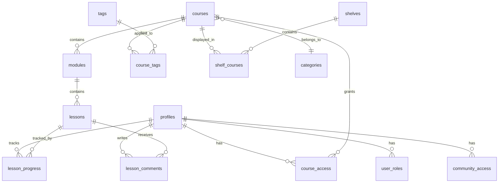
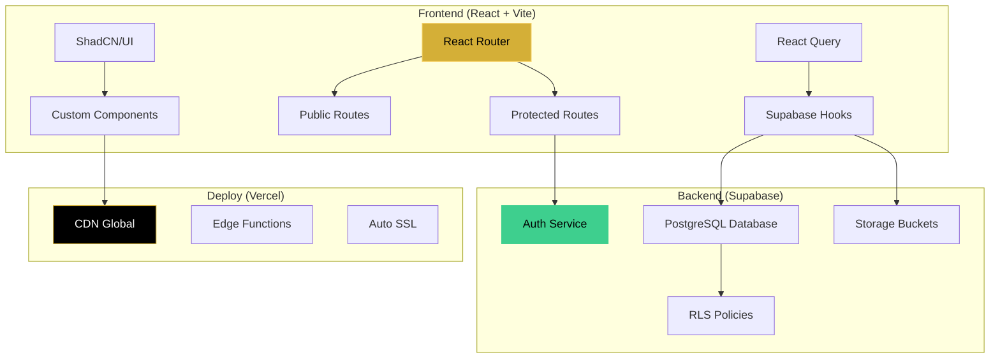
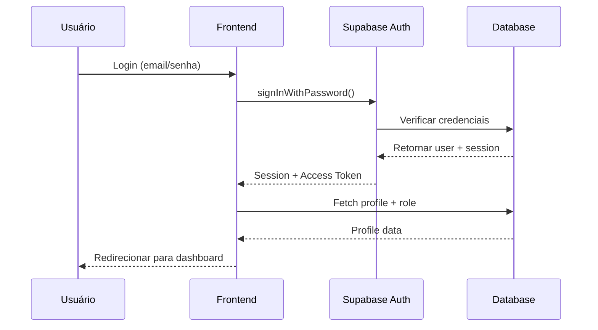

# 🏆 MemberHero - Área de Membros Premium

<div align="center">


**Plataforma completa de área de membros para cursos online, com experiência premium estilo Netflix.**

[Documentação](#-documentação) · [Deploy](#-deploy-na-vercel)

</div>

---

## 📑 Índice

- [Sobre o Projeto](#-sobre-o-projeto)
- [Stack Tecnológica](#-stack-tecnológica)
- [Funcionalidades](#-funcionalidades)
- [Estrutura do Banco de Dados](#-estrutura-do-banco-de-dados)
- [Arquitetura](#-arquitetura)
- [Estrutura do Projeto](#-estrutura-do-projeto)
- [Instalação Local](#-instalação-local)
- [Variáveis de Ambiente](#-variáveis-de-ambiente)
- [Deploy na Vercel](#-deploy-na-vercel)
- [Sistema de Autenticação](#-sistema-de-autenticação)
- [Design System](#-design-system)
- [Scripts Disponíveis](#-scripts-disponíveis)
- [Storage Buckets](#-storage-buckets)
- [Troubleshooting](#-troubleshooting)
- [Licença](#-licença)

---

## 🎯 Sobre o Projeto

MemberHero é uma plataforma completa de área de membros para cursos online, desenvolvida com as melhores tecnologias do mercado. Oferece uma experiência premium inspirada no Netflix, com player de vídeo avançado, controle de progresso e gerenciamento completo de conteúdo.

### 🌟 Principais Diferenciais

- 🎬 **Vitrine Estilo Netflix** - Interface moderna com prateleiras customizáveis
- 📺 **Player Premium** - Suporte a YouTube e Vimeo com controles avançados
- 🔒 **Controle de Acesso** - Sistema robusto de permissões por curso
- 📊 **Dashboard Admin** - Métricas em tempo real e gerenciamento completo
- 🎨 **Design Dark Gold** - Interface elegante e profissional
- ⚡ **Performance** - Build otimizado com Vite e React 18
- 🔐 **Segurança** - RLS policies no Supabase e roles separados

---

## 🚀 Stack Tecnológica

<table>
  <tr>
    <th>Categoria</th>
    <th>Tecnologia</th>
    <th>Versão</th>
  </tr>
  <tr>
    <td><strong>Frontend</strong></td>
    <td>React + TypeScript + Vite</td>
    <td>18.3 / 5.5 / 5.4</td>
  </tr>
  <tr>
    <td><strong>Estilização</strong></td>
    <td>Tailwind CSS + ShadCN/UI</td>
    <td>3.4 / Latest</td>
  </tr>
  <tr>
    <td><strong>Backend</strong></td>
    <td>Supabase (Auth + Database + Storage)</td>
    <td>2.86+</td>
  </tr>
  <tr>
    <td><strong>State Management</strong></td>
    <td>React Query (TanStack Query)</td>
    <td>5.83</td>
  </tr>
  <tr>
    <td><strong>Roteamento</strong></td>
    <td>React Router DOM</td>
    <td>6.30</td>
  </tr>
  <tr>
    <td><strong>Player de Vídeo</strong></td>
    <td>React YouTube + Vimeo Player</td>
    <td>10.1 / 2.30</td>
  </tr>
  <tr>
    <td><strong>Forms</strong></td>
    <td>React Hook Form + Zod</td>
    <td>7.61 / 3.25</td>
  </tr>
  <tr>
    <td><strong>Drag & Drop</strong></td>
    <td>@dnd-kit</td>
    <td>6.3+</td>
  </tr>
  <tr>
    <td><strong>Gráficos</strong></td>
    <td>Recharts</td>
    <td>2.15</td>
  </tr>
  <tr>
    <td><strong>Ícones</strong></td>
    <td>Lucide React</td>
    <td>0.462</td>
  </tr>
</table>

---

## ✨ Funcionalidades

### 👨‍🎓 Área do Aluno

- ✅ **Vitrine Estilo Netflix**
  - Prateleiras horizontais customizáveis
  - Banner principal dinâmico
  - Cards com hover effects premium
  
- ✅ **Player de Vídeo Premium**
  - Suporte a YouTube e Vimeo
  - Controle de velocidade (0.5x, 0.75x, 1x, 1.25x, 1.5x, 1.75x, 2x)
  - Controle de volume com mute
  - Fullscreen nativo
  - Picture-in-Picture
  - Atalhos de teclado (Espaço, M, F, Setas)
  
- ✅ **Progresso de Aulas**
  - Salvamento automático a cada 5 segundos
  - Retomar de onde parou
  - Barra de progresso visual
  - Marcação de aulas concluídas
  
- ✅ **Navegação Intuitiva**
  - Lista de módulos e aulas
  - Próxima aula automática
  - Breadcrumbs de navegação
  
- ✅ **Cursos Bloqueados**
  - Visualização com blur effect
  - CTA para checkout externo
  - Sistema de liberação automática
  
- ✅ **Sistema de Notificações**
  - Notificações em tempo real
  - Bell icon com contador
  - Histórico completo
  
- ✅ **Comunidade**
  - Área exclusiva para membros
  - Seções configuráveis (Avisos, Encontros, Materiais, etc.)
  - Prateleiras de conteúdo
  
- ✅ **Perfil do Usuário**
  - Edição de informações
  - Upload de avatar
  - Histórico de progresso

### 👨‍💼 Área Admin

- ✅ **Dashboard com Métricas**
  - Total de receita
  - Alunos registrados
  - Cursos publicados
  - Taxa de conclusão
  - Gráfico de vendas (Recharts)
  - Top 3 cursos
  
- ✅ **Gerenciamento de Cursos**
  - CRUD completo (Create, Read, Update, Delete)
  - Upload de imagens (capa e banner)
  - Editor de descrição rica
  - Sistema de categorias
  - Sistema de tags
  - Status (Publicado/Rascunho)
  - URL de checkout externa
  - Tag de integração (Hotmart, Monetizze, Eduzz, etc.)
  
- ✅ **Gerenciamento de Módulos**
  - Organização hierárquica
  - Reordenação drag & drop
  - Upload de imagem ilustrativa
  - Controle de ordem
  
- ✅ **Gerenciamento de Aulas**
  - Tipos suportados: Vídeo, PDF, Arquivo, Link Externo
  - Upload de PDFs para Supabase Storage
  - Materiais extras anexos
  - URL de vídeo (YouTube/Vimeo)
  - Thumbnail personalizada
  - Reordenação drag & drop
  
- ✅ **Upload e Validação**
  - Validação de dimensões de imagens
  - Compressão automática
  - Preview antes do upload
  - Upload para Supabase Storage (bucket `media`)
  
- ✅ **Configuração de Vitrine**
  - Criar/editar prateleiras (shelves)
  - Tipos: Manual ou Automática
  - Adicionar cursos às prateleiras
  - Reordenação drag & drop
  - Ativar/desativar prateleiras
  - Preview da vitrine do aluno
  
- ✅ **Sistema de Categorias e Tags**
  - CRUD de categorias
  - CRUD de tags
  - Cores personalizadas
  - Vinculação a cursos
  
- ✅ **Gerenciamento de Alunos**
  - Lista completa de alunos
  - Visualização de progresso
  - Controle de acesso por curso
  - Sistema de roles (Admin/Student)
  - Status do aluno (Ativo/Inativo/Bloqueado)
  - Função `promote_to_admin(email)`
  
- ✅ **Configuração de Webhooks**
  - Adicionar/editar webhooks
  - Teste de webhooks
  - Logs de requisições
  - Integrações com plataformas de pagamento
  
- ✅ **Configuração de Comunidade**
  - Configurações gerais (nome, descrição, cores)
  - Banner principal
  - Seções personalizáveis
  - Prateleiras de conteúdo
  - Controle de acesso individual
  - Vincular cursos e módulos
  
- ✅ **Configurações Gerais**
  - Nome da plataforma
  - Cores personalizadas
  - Logo e favicon
  - Mensagem de boas-vindas
  - Email de suporte
  - Integrações (Google Analytics, Facebook Pixel)
  - Modo de manutenção
  - Permitir registro

---

## 🗄️ Estrutura do Banco de Dados

### Tabelas Principais

```
📦 Banco de Dados (Supabase PostgreSQL)
│
├── 👤 profiles              # Perfis de usuário
├── 🔑 user_roles            # Roles (admin/student)
├── 📚 courses               # Cursos
├── 📂 modules               # Módulos dos cursos
├── 🎬 lessons               # Aulas (vídeo, PDF, arquivo, externo)
├── 📊 lesson_progress       # Progresso do aluno nas aulas
├── 💬 lesson_comments       # Comentários nas aulas
├── 🔓 course_access         # Controle de acesso aos cursos
├── 🏷️ categories            # Categorias de cursos
├── 🏷️ tags                  # Tags de cursos
├── 🔗 course_tags           # Relação curso-tags
├── 📺 shelves               # Prateleiras da vitrine Netflix
├── 🔗 shelf_courses         # Cursos nas prateleiras
├── 🏛️ community_settings    # Configurações da comunidade
├── 🔓 community_access      # Controle de acesso à comunidade
└── ⚙️ app_settings          # Configurações gerais da plataforma
```

### Diagrama Entidade-Relacionamento (Simplificado)



### Enums do Sistema

| Enum | Valores |
|------|---------|
| `app_role` | `admin`, `student` |
| `course_status` | `Publicado`, `Rascunho` |
| `lesson_type` | `video`, `pdf`, `arquivo`, `externo` |
| `shelf_type` | `automatica`, `manual` |
| `student_status` | `ativo`, `inativo`, `bloqueado` |

### Funções do Banco de Dados

- **`has_role(user_id, role)`** - Verifica se usuário tem role específico (usado em RLS policies)
- **`promote_to_admin(user_email)`** - Promove usuário a admin
- **`handle_new_user()`** - Trigger para criar profile e role ao registrar
- **`update_lesson_comments_updated_at()`** - Trigger para atualizar timestamp de comentários

---

## 🏗️ Arquitetura



### Fluxo de Autenticação



---

## 📁 Estrutura do Projeto

```
memberhero/
│
├── public/                      # Assets estáticos
│   ├── favicon.svg
│   ├── robots.txt
│   └── placeholder.svg
│
├── src/
│   ├── components/              # Componentes React
│   │   ├── admin/              # 20+ componentes admin
│   │   │   ├── AdminLayout.tsx
│   │   │   ├── AdminSidebar.tsx
│   │   │   ├── AdminTopbar.tsx
│   │   │   ├── MetricCard.tsx
│   │   │   ├── SalesChart.tsx
│   │   │   ├── course/         # Componentes de curso
│   │   │   └── ...
│   │   ├── student/            # 15+ componentes aluno
│   │   │   ├── StudentLayout.tsx
│   │   │   ├── HorizontalShelf.tsx
│   │   │   ├── CourseCardVertical.tsx
│   │   │   ├── lesson/         # Player de vídeo
│   │   │   └── ...
│   │   ├── auth/               # Autenticação
│   │   │   └── ProtectedRoute.tsx
│   │   ├── community/          # Comunidade
│   │   └── ui/                 # 40+ componentes ShadCN
│   │
│   ├── contexts/               # Context Providers
│   │   └── AuthContext.tsx    # Context de autenticação
│   │
│   ├── hooks/                  # Custom React Hooks
│   │   ├── useAuth.ts
│   │   ├── useSupabaseAuth.ts
│   │   ├── useSupabaseCourses.ts
│   │   ├── useSupabaseLessons.ts
│   │   ├── useSupabaseModules.ts
│   │   ├── useStudentProgress.ts
│   │   ├── useVideoPlayer.ts
│   │   └── ...                # 30+ hooks
│   │
│   ├── integrations/          # Integrações
│   │   └── supabase/
│   │       ├── client.ts      # Cliente Supabase
│   │       └── types.ts       # Types gerados
│   │
│   ├── pages/                 # Páginas da aplicação
│   │   ├── admin/             # 16 páginas admin
│   │   │   ├── Dashboard.tsx
│   │   │   ├── Courses.tsx
│   │   │   ├── CourseForm.tsx
│   │   │   ├── CourseManagement.tsx
│   │   │   ├── ModulesListing.tsx
│   │   │   ├── ModuleForm.tsx
│   │   │   ├── LessonsListing.tsx
│   │   │   ├── LessonForm.tsx
│   │   │   ├── ShowcaseConfig.tsx
│   │   │   ├── CategoriesAndTags.tsx
│   │   │   ├── Students.tsx
│   │   │   ├── Settings.tsx
│   │   │   ├── CommunityConfig.tsx
│   │   │   ├── WebhooksConfig.tsx
│   │   │   ├── WebhookLogs.tsx
│   │   │   └── DataMigration.tsx
│   │   ├── student/           # 7 páginas aluno
│   │   │   ├── Showcase.tsx
│   │   │   ├── MyCourses.tsx
│   │   │   ├── LessonPlayer.tsx
│   │   │   ├── Community.tsx
│   │   │   ├── Profile.tsx
│   │   │   ├── Notifications.tsx
│   │   │   └── StudentSettings.tsx
│   │   ├── auth/              # Autenticação
│   │   │   ├── Login.tsx
│   │   │   ├── LoginNew.tsx
│   │   │   ├── Register.tsx
│   │   │   └── RegisterNew.tsx
│   │   └── NotFound.tsx
│   │
│   ├── types/                 # TypeScript types
│   │   └── video.ts
│   │
│   ├── utils/                 # Utilitários
│   │   ├── migrateToSupabase.ts
│   │   ├── uploadToStorage.ts
│   │   └── createTestData.ts
│   │
│   ├── App.tsx                # Componente raiz
│   ├── main.tsx               # Entry point
│   └── index.css              # Estilos globais + Design tokens
│
├── supabase/                  # Configuração Supabase
│   ├── config.toml
│   └── migrations/            # Migrations SQL
│
├── .env                       # Variáveis de ambiente (não commitado)
├── vercel.json               # Configuração Vercel
├── tailwind.config.ts        # Config Tailwind
├── vite.config.ts            # Config Vite
├── tsconfig.json             # Config TypeScript
└── package.json              # Dependências
```

---

## 💻 Instalação Local

### Pré-requisitos

- Node.js 18+ e npm/yarn
- Conta no Supabase (gratuita)
- Git

### Passo a Passo

```bash
# 1. Clonar o repositório
git clone https://github.com/seu-usuario/memberhero.git
cd memberhero

# 2. Instalar dependências
npm install

# 3. Configurar variáveis de ambiente
# Criar arquivo .env na raiz do projeto com:
VITE_SUPABASE_URL=https://seu-projeto.supabase.co
VITE_SUPABASE_PUBLISHABLE_KEY=sua_anon_key_aqui
VITE_SUPABASE_PROJECT_ID=seu_project_id

# 4. Iniciar servidor de desenvolvimento
npm run dev

# 5. Acessar no navegador
# http://localhost:5173
```

### Configuração do Supabase

1. **Criar projeto no Supabase**
   - Acessar [supabase.com](https://supabase.com)
   - Criar novo projeto
   - Anotar URL e Anon Key

2. **Executar migrations**
   - Ir em SQL Editor no dashboard
   - Executar as migrations da pasta `supabase/migrations/`
   - Ordem cronológica (por timestamp)

3. **Criar buckets de storage**
   - Ir em Storage no dashboard
   - Criar bucket `media` (público)
   - Criar bucket `community-images` (público)

4. **Configurar Authentication**
   - Ir em Authentication → Settings
   - Ativar "Email" provider
   - Desabilitar "Confirm email" (para testes locais)

5. **Criar primeiro admin**
   - Registrar usuário pela interface
   - Executar SQL:
     ```sql
     SELECT promote_to_admin('seuemail@exemplo.com');
     ```

---

## 🔐 Variáveis de Ambiente

### Arquivo `.env`

```env
# Supabase (Obrigatório)
VITE_SUPABASE_URL=https://cejolkljegdmawvaebow.supabase.co
VITE_SUPABASE_PUBLISHABLE_KEY=eyJhbGciOiJIUzI1NiIsInR5cCI6IkpXVCJ9...
VITE_SUPABASE_PROJECT_ID=cejolkljegdmawvaebow
```

### Descrição das Variáveis

| Variável | Descrição | Onde Encontrar |
|----------|-----------|----------------|
| `VITE_SUPABASE_URL` | URL do projeto Supabase | Dashboard → Settings → API |
| `VITE_SUPABASE_PUBLISHABLE_KEY` | Chave pública (anon key) | Dashboard → Settings → API |
| `VITE_SUPABASE_PROJECT_ID` | ID do projeto | URL do dashboard |

> ⚠️ **Importante**: Todas as variáveis começam com `VITE_` pois o Vite só expõe variáveis com esse prefixo para o frontend.

> ✅ **Segurança**: A `PUBLISHABLE_KEY` (anon key) é segura para uso no frontend. Ela respeita as RLS policies configuradas no banco.

---

## 🚀 Deploy na Vercel

### Opção 1: Deploy via GitHub (Recomendado)

#### 1. Conectar ao GitHub

```bash
# Se ainda não tem repositório no GitHub:
git init
git add .
git commit -m "Initial commit"
git branch -M main
git remote add origin https://github.com/seu-usuario/memberhero.git
git push -u origin main
```

#### 2. Importar no Vercel

1. Acessar [vercel.com](https://vercel.com)
2. Clicar em **"New Project"**
3. Importar repositório do GitHub
4. Configurar build settings:
   - **Framework Preset**: Vite (detectado automaticamente)
   - **Build Command**: `npm run build`
   - **Output Directory**: `dist`
   - **Install Command**: `npm install`

#### 3. Configurar Variáveis de Ambiente

Na tela de configuração do projeto, ou depois em **Settings → Environment Variables**, adicionar:

```
VITE_SUPABASE_URL = https://seu-projeto.supabase.co
VITE_SUPABASE_PUBLISHABLE_KEY = sua_anon_key
VITE_SUPABASE_PROJECT_ID = seu_project_id
```

> 💡 **Dica**: Adicionar para Production, Preview e Development

#### 4. Deploy

- Clicar em **"Deploy"**
- Aguardar build (~1-2 minutos)
- ✅ Projeto no ar!

### Opção 2: Deploy via CLI

```bash
# 1. Instalar Vercel CLI
npm i -g vercel

# 2. Login
vercel login

# 3. Deploy
vercel

# 4. Deploy para produção
vercel --prod
```

### Configuração do `vercel.json`

O projeto já inclui o arquivo `vercel.json` configurado:

```json
{
  "$schema": "https://openapi.vercel.sh/vercel.json",
  "buildCommand": "npm run build",
  "devCommand": "npm run dev",
  "installCommand": "npm install",
  "framework": "vite",
  "outputDirectory": "dist",
  "rewrites": [
    {
      "source": "/(.*)",
      "destination": "/index.html"
    }
  ],
  "headers": [
    {
      "source": "/assets/(.*)",
      "headers": [
        {
          "key": "Cache-Control",
          "value": "public, max-age=31536000, immutable"
        }
      ]
    }
  ]
}
```

**O que faz:**
- ✅ **rewrites**: Garante que todas as rotas funcionem (SPA routing)
- ✅ **headers**: Cache de 1 ano para assets estáticos (performance)

### Domínio Customizado (Opcional)

1. Ir em **Settings → Domains**
2. Adicionar domínio customizado
3. Configurar DNS conforme instruções
4. HTTPS automático via Let's Encrypt

### Monitoramento

- **Logs**: Deployments → Ver logs em tempo real
- **Analytics**: Analytics tab (gratuito)
- **Speed Insights**: Performance metrics

---

## 🔒 Sistema de Autenticação

### Fluxo de Autenticação

1. **Registro**
   - Usuário preenche nome, email e senha
   - Supabase cria user em `auth.users`
   - Trigger `handle_new_user()` cria profile e role `student`
   
2. **Login**
   - Usuário envia email/senha
   - Supabase valida e retorna session
   - Frontend busca profile + role
   - Redireciona conforme role (admin → /admin, student → /student/showcase)

3. **Verificação de Role**
   - Function `has_role(user_id, role)` verifica em `user_roles`
   - Usada em RLS policies e rotas protegidas

4. **Logout**
   - Limpa session do Supabase
   - Redireciona para login

### Roles do Sistema

| Role | Acesso |
|------|--------|
| `admin` | Dashboard, CRUD de cursos, gerenciamento de alunos, configurações |
| `student` | Vitrine, cursos liberados, player, perfil, comunidade |

### Rotas Protegidas

```tsx
// Exemplo de rota protegida por role
<Route
  path="/admin/*"
  element={
    <ProtectedRoute requiredRole="admin">
      <AdminLayout />
    </ProtectedRoute>
  }
/>
```

### Promover Usuário a Admin

```sql
-- Via SQL Editor no Supabase
SELECT promote_to_admin('email@usuario.com');
```

### Recuperação de Senha

1. Na tela de login → "Esqueci minha senha"
2. Supabase envia email com link mágico
3. Usuário clica e define nova senha

---

## 🎨 Design System

### Tema: Dark Premium + Gold

O MemberHero utiliza um design system consistente baseado em **semantic tokens** definidos em `src/index.css` e `tailwind.config.ts`.

### Paleta de Cores

```css
/* Tokens CSS (HSL) */
:root {
  /* Background */
  --background: 0 0% 0%;           /* #000000 */
  --surface: 0 0% 4%;              /* #0A0A0A */
  
  /* Text */
  --foreground: 0 0% 100%;         /* #FFFFFF */
  --muted-foreground: 0 0% 70%;    /* rgba(255,255,255,0.7) */
  
  /* Primary (Gold) */
  --primary: 43 74% 53%;           /* #D4AF37 */
  --primary-hover: 44 88% 70%;     /* #F5D46E */
  
  /* Borders */
  --border: 0 0% 100% / 0.12;      /* rgba(255,255,255,0.12) */
  
  /* Glass */
  --glass-bg: 0 0% 100% / 0.05;
  --glass-border: 0 0% 100% / 0.12;
}
```

### Uso em Componentes

```tsx
// ❌ ERRADO - Cores diretas
<div className="bg-black text-white border-[#D4AF37]">

// ✅ CORRETO - Semantic tokens
<div className="bg-background text-foreground border-primary">
```

### Glassmorphism

Aplicado em cards, modais e containers:

```css
.glass-card {
  background: hsl(var(--glass-bg));
  border: 1px solid hsl(var(--glass-border));
  backdrop-filter: blur(12px);
  border-radius: 12px;
}
```

### Componentes ShadCN Customizados

Todos os componentes ShadCN foram customizados para o tema Dark Gold:

- `Button` - Variante `premium` dourada
- `Card` - Glass background
- `Input` - Border dourado no focus
- `Dialog` - Backdrop blur
- `Table` - Hover com dourado

### Tipografia

- **Fonte**: System font stack otimizada
- **Headings**: Font weight 700
- **Body**: Font weight 400
- **Muted**: Font weight 400 + opacity 70%

---

## 📜 Scripts Disponíveis

| Comando | Descrição |
|---------|-----------|
| `npm run dev` | Inicia servidor de desenvolvimento (porta 5173) |
| `npm run build` | Build otimizado para produção |
| `npm run build:dev` | Build em modo desenvolvimento (sourcemaps) |
| `npm run preview` | Preview do build de produção |
| `npm run lint` | Executa ESLint para verificar código |

### Build para Produção

```bash
npm run build
```

Saída em `/dist`:
- Bundle JavaScript minificado
- CSS com Tailwind purgado
- Assets otimizados
- Sourcemaps para debug

---

## 📱 Responsividade

O MemberHero é **totalmente responsivo** e otimizado para todos os dispositivos.

### Breakpoints

```ts
// tailwind.config.ts
screens: {
  'sm': '640px',   // Mobile landscape
  'md': '768px',   // Tablet
  'lg': '1024px',  // Laptop
  'xl': '1280px',  // Desktop
  '2xl': '1536px', // Large desktop
}
```

### Testes Recomendados

- 📱 iPhone SE (375px)
- 📱 iPhone 12 Pro (390px)
- 📱 Samsung Galaxy S20 (412px)
- 📱 iPad (768px)
- 💻 Laptop (1024px)
- 💻 Desktop (1920px)

### Mobile-First

Todos os componentes seguem abordagem **mobile-first**:

```tsx
<div className="
  grid grid-cols-1       /* Mobile: 1 coluna */
  md:grid-cols-2        /* Tablet: 2 colunas */
  lg:grid-cols-3        /* Desktop: 3 colunas */
">
```

---

## 📦 Storage Buckets

### Buckets do Supabase

| Bucket | Uso | Público | Tamanho Máx |
|--------|-----|---------|-------------|
| `media` | Imagens de cursos, módulos, aulas, thumbnails | ✅ Sim | 50MB/arquivo |
| `community-images` | Imagens da comunidade, banners | ✅ Sim | 50MB/arquivo |

### Como Fazer Upload

```tsx
import { uploadToStorage } from '@/utils/uploadToStorage';

// Upload de imagem
const imageUrl = await uploadToStorage(file, 'media');
```

### Políticas de Storage

```sql
-- Exemplo de policy para upload
CREATE POLICY "Admins can upload to media"
ON storage.objects FOR INSERT
TO authenticated
WITH CHECK (
  bucket_id = 'media' AND
  has_role(auth.uid(), 'admin')
);
```

---

## 🔧 Troubleshooting

### Problema: 404 em Rotas no Deploy

**Causa**: Falta configuração de SPA routing no servidor.

**Solução**: Verificar se `vercel.json` tem o rewrite configurado:

```json
{
  "rewrites": [
    {
      "source": "/(.*)",
      "destination": "/index.html"
    }
  ]
}
```

---

### Problema: Imagens Não Carregam

**Causa**: Bucket não está público ou policies incorretas.

**Solução**:
1. Ir em Storage → Buckets
2. Editar bucket → Public: ON
3. Verificar policies de SELECT

---

### Problema: Erro de Autenticação

**Causa**: Variáveis de ambiente incorretas.

**Solução**:
1. Verificar `.env` localmente
2. Verificar Environment Variables na Vercel
3. Redeploy após alterar variáveis

---

### Problema: "Cannot read properties of null"

**Causa**: Dados ainda não carregados (loading state).

**Solução**: Adicionar verificação:

```tsx
if (isLoading) return <Spinner />;
if (!data) return null;
```

---

### Problema: Erro de CORS

**Causa**: Requisição bloqueada por CORS policy.

**Solução**: Supabase já configura CORS automaticamente. Se persistir, verificar URL do projeto.

---

### Problema: Build Falha no Vercel

**Causa**: TypeScript errors ou dependências faltando.

**Solução**:
1. Rodar `npm run build` localmente
2. Corrigir erros de TypeScript
3. Verificar `package.json`

---

## 📄 Licença

© 2024 MemberHero. Todos os direitos reservados.

Este projeto é proprietário e confidencial. Uso, cópia, modificação e distribuição são proibidos sem autorização expressa.

---

## 🙏 Créditos

**Desenvolvido com:**

- [React](https://react.dev) - Biblioteca UI
- [TypeScript](https://www.typescriptlang.org/) - Type safety
- [Vite](https://vitejs.dev/) - Build tool
- [Tailwind CSS](https://tailwindcss.com/) - Estilização
- [ShadCN/UI](https://ui.shadcn.com/) - Componentes
- [Supabase](https://supabase.com/) - Backend as a Service
- [React Query](https://tanstack.com/query) - State management
- [Lucide Icons](https://lucide.dev/) - Ícones
- [Recharts](https://recharts.org/) - Gráficos

---

<div align="center">

**Desenvolvido com ❤️ e ☕**

[Suporte](mailto:suporte@memberhero.com)

</div>
